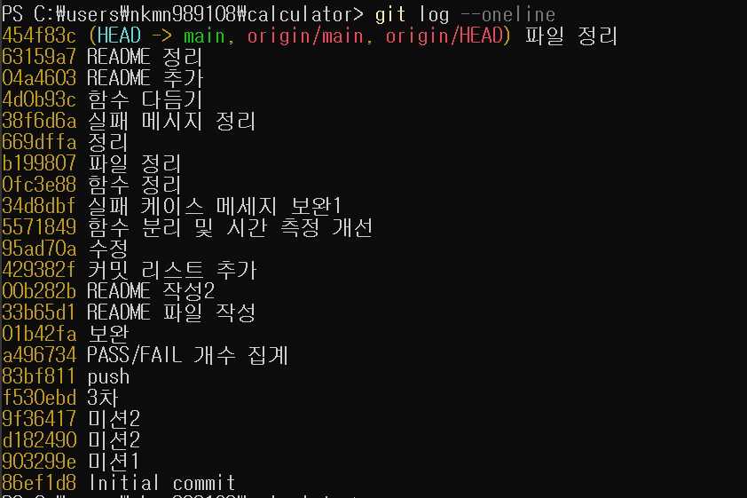

# MAC 연산 기반 패턴 판정기

필터(Filter)와 입력 패턴(Pattern)의 **MAC(Multiply-Accumulate) 연산** 점수를 비교하여, 패턴이 어떤 필터(Cross `+` / X)와 더 유사한지 판정하는 파이썬 프로그램입니다.

## MAC 연산이란?

두 행렬의 같은 위치 원소를 서로 곱한 뒤 모두 더하는 연산입니다. CNN(합성곱 신경망)의 필터 연산이 이 원리를 기반으로 합니다.

```
score = Σ (filter[i][j] × pattern[i][j])
```

점수가 높을수록 패턴이 해당 필터와 더 많이 겹친다는 뜻입니다.

```
필터(Cross)     패턴          곱
0 1 0          0 1 0        0 1 0
1 1 1    ×     1 1 1   →    1 1 1   → 합 = 5
0 1 0          0 1 0        0 1 0
```

## 주요 기능

| 모드 | 설명 |
|------|------|
| 1. 사용자 입력 (3x3) | 필터 A, 필터 B, 패턴을 직접 입력하고 MAC 점수를 비교해 A/B 중 더 유사한 필터를 판정 |
| 2. data.json 분석 | `data.json`의 필터(Cross, X)와 패턴(size 5 / 13 / 25)을 불러와 일괄 판정, 성능 및 결과 요약 출력 |

## 실행 방법

```bash
python main.py
```

실행하면 모드를 선택하는 메뉴가 나옵니다.

```
1. 사용자 입력 (3x3)
2. data.json 분석
선택:
```

### 모드 1: 사용자 입력

3x3 행렬을 한 줄에 세 개의 정수로, 공백으로 구분해 입력합니다.

```
선택:1
필터 A 3줄 입력, 공백 구분
0 1 0
1 1 1
0 1 0
필터 B 3줄 입력, 공백 구분
1 0 1
0 1 0
1 0 1
패턴 3줄 입력, 공백 구분
0 1 0
1 1 1
0 1 0
```

- 두 점수의 차이가 `1e-9` 미만이면 "판정 불가"로 처리합니다.
- 그 외에는 점수가 높은 쪽(A 또는 B)을 판정 결과로 출력하고 연산 시간을 표시합니다.

### 모드 2: data.json 분석

같은 폴더의 `data.json`을 읽어 아래 순서로 처리합니다.

1. **필터 로드**: size_5, size_13, size_25 필터(Cross, X) 로드
2. **패턴 분석**: 크기별 패턴 2개씩(총 6개)에 대해 Cross 점수와 X 점수를 계산하고 더 높은 쪽으로 판정
3. **성능 분석**: 크기별 평균 연산 시간(ms)과 연산 횟수(N²) 출력
4. **결과 요약**: 총 테스트 수, 통과 수, 실패 수 출력

## data.json 구조

> 코드에서 접근하는 키를 기준으로 정리한 구조입니다.

```json
{
  "filters": {
    "size_5":  { "cross": [[...]], "x": [[...]] },
    "size_13": { "cross": [[...]], "x": [[...]] },
    "size_25": { "cross": [[...]], "x": [[...]] }
  },
  "patterns": {
    "size_5_1": { "input": [[...]] },
    "size_5_2": { "input": [[...]] },
    "size_13_1": { "input": [[...]] },
    "...": {}
  }
}
```

- 파일이 없으면 빈 목록(`[]`)으로 시작합니다.
- JSON 형식이 손상된 경우 안내 메시지를 출력하고 빈 목록으로 시작합니다.

## 코드 구성

| 함수 / 변수 | 역할 |
|-------------|------|
| `load_data(FILENAME)` | JSON 파일을 읽어 반환 (파일 없음·손상 시 `[]`) |
| `mac(data0, data1)` | 두 행렬의 MAC 점수 계산 |
| `input_matrix()` | 3줄을 입력받아 3x3 정수 행렬로 변환 |
| `LABEL_MAP`, `normalize_label(label)` | `+`, `cross`, `plus` → `cross` / `x`, `×` → `x` 로 라벨 정규화 |

## 판정 규칙

- `|Cross 점수 − X 점수| < 1e-9` → **UNDECIDED (동점 규칙, FAIL 처리)**
- Cross 점수가 더 높음 → **Cross**
- 그 외 → **X**

### 진단 순서

```
(1) 스키마 검증 (키, 형태, 타입, 크기, 라벨)
     └ 실패 → [데이터/스키마]
(2) 점수 계산 후 NaN/inf 검사
     └ 실패 → [수치 비교]
(3) 같은 계산을 십진 정수 연산(오차 없는 정확 계산)으로 재현해 비교
     ├ PASS → 통과
     ├ float 판정 ≠ 정확 판정 → [수치 비교] (오차 또는 EPSILON 문제)
     └ float 판정 = 정확 판정인데 기대와 다름 → [로직]
```

핵심은 (3)입니다. `to_decimal(0.1)`은 `repr`로 얻은 십진 문자열을 `(1, -1)`, 즉 1×10⁻¹ 이라는 **정수 쌍**으로 분해하고 점수 계산을 정수 곱셈·덧셈으로만 수행하므로 오차가 생기지 않습니다.

- float와 정확 계산의 판정이 다르면 → 부동소수점 오차 또는 `EPSILON` 때문입니다.
- 둘이 같은데 기대 라벨과 다르면 → 오차가 아니라 데이터 의미나 규칙의 문제입니다.

## 결과 리포트 (최소 10줄 이상)
- 실패 원인 분석

| 분류 | 의미 | 대표 증상 | 확인할 곳 |
|------|------|-----------|-----------|
| **데이터/스키마** (`SCHEMA`) | 입력이 계산 가능한 형태가 아님 | 키 누락, 정사각 행렬 아님, 숫자가 아닌 값, 필터·패턴 크기 불일치, 알 수 없는 `expected` 라벨 | `data.json`, `LABEL_MAP` |
| **로직** (`LOGIC`) | 정확히 계산해도 결과가 기대와 다름 | 판정 ≠ 기대 라벨, 정확히 동점(필터가 구분 못함) | 필터 키(`cross`/`x`) 뒤바뀜, `expected` 오기입, 판정 규칙 |
| **수치 비교** (`NUMERIC`) | 부동소수점·임계값 때문에 판정이 뒤집힘 | float 판정 ≠ 정확 계산 판정, `NaN`/`inf` | `EPSILON` 크기, 자료형 |

- 시간 복잡도 분석 

| 대상 | 시간 복잡도 | 설명 |
|------|-------------|------|
| `mac()` (MAC 1회) | **Θ(N²)** | 곱셈 N²번, 덧셈 N²번 |
| `analyze_case()` (패턴 1개 진단) | **O(R·N²) = O(N²)** | `R`은 상수(20)이므로 N에 대해 이차 |
| 모드 2 전체 | **O(Σ Nₖ²) ≤ O(K·N²)** | 패턴마다 자기 크기의 제곱만큼 계산 |
| 모드 1 | **O(1)** | 3×3 고정이라 연산량이 일정 |

한 줄로 정리하면, **연산량은 행렬 크기의 제곱에 비례**합니다. 크기를 2배로 키우면 걸리는 시간은 약 4배가 됩니다.

- 실패가 0인 경우 "왜 실패가 O이 되었는지(정규화/epsilon) 정책"
모든 케이스에서, 두 가지 필터 중에 하나의 필터와 패턴이 들어맞으며, 
즉 한 필터와의 스코어가 다른 필터보다 유의미하게 크며, 
입력이 계산 가능하고 정확히 계산되었으며 
스코어 차이가 epsilon보다 클 경우 실패가 0이 됩니다.

## Epsilon 사용 이유
- 부동소수점 오차는 "이진수로 유한 비트에 저장하며 반올림하기 때문에" 생기고, epsilon은 누적 오차보다는 크고 의미 있는 차이보다는 작게 잡아야 합니다. float64 환경에서는 1e-9가 안전한 관례적 선택입니다.

## git commit 리스트



## 실행 화면

1. 


2.
